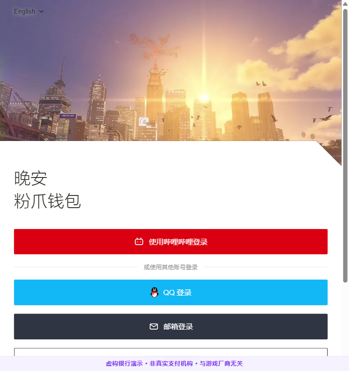
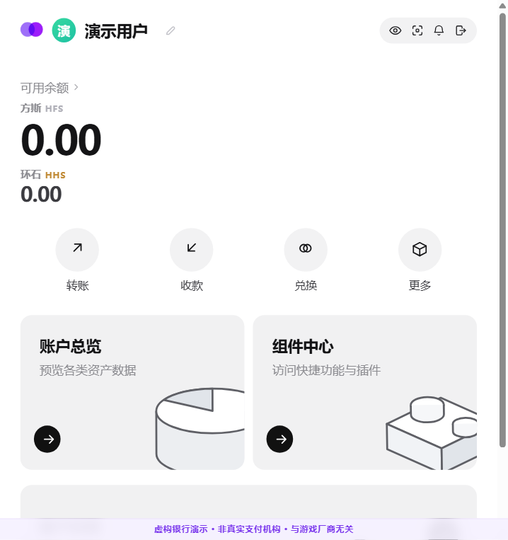
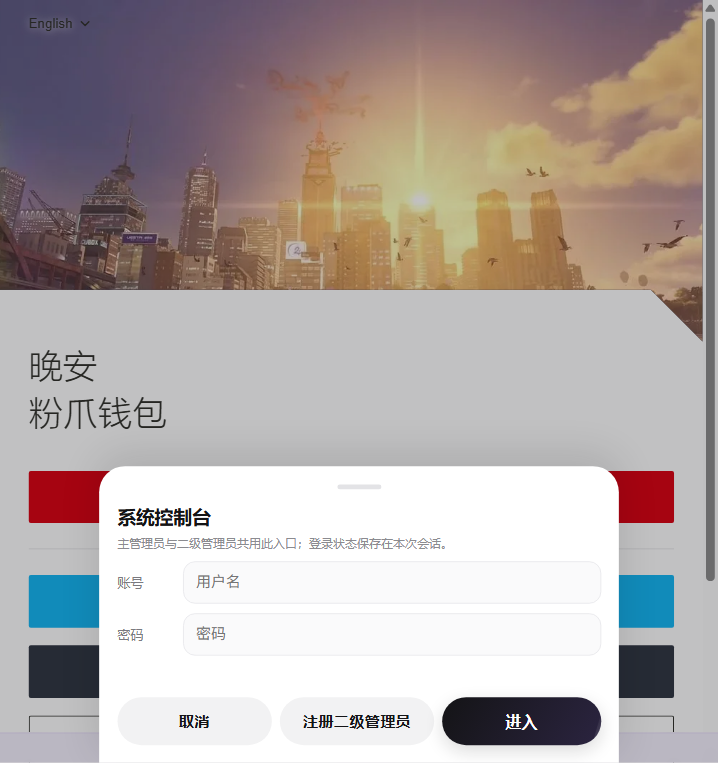
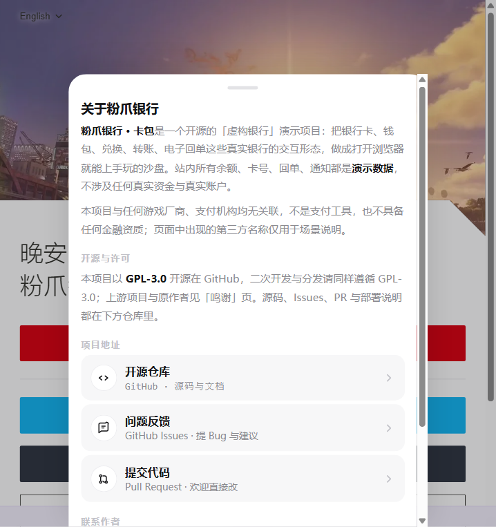
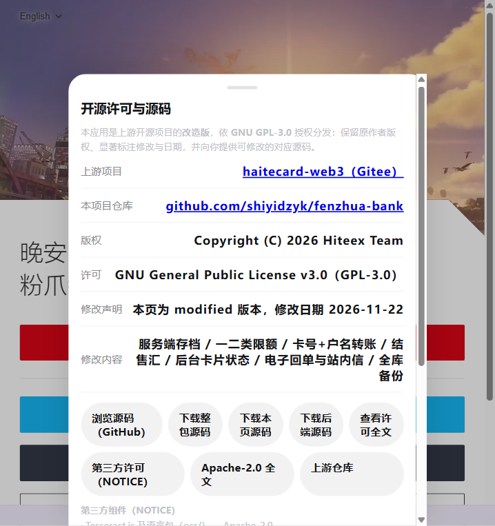

# Pink Claw Bank · Card Wallet

A "fictional bank" demo that really logs in, really stores data and really moves numbers around: card issuing, a two-currency wallet, FX buy/sell, transfers and e-receipts, all packaged as a browser sandbox that mimics a real banking app. Every balance, card number, transaction and receipt is demo data. No real money is involved anywhere.

- Live demo: <https://fenzhua.yzz.me/>
- This repository: <https://github.com/shiyidzyk/fenzhua-bank>
- Developer / handover manual: [DEVELOPMENT.en.md](DEVELOPMENT.en.md) · [中文](DEVELOPMENT.md)
- Changelog: [CHANGELOG.en.md](CHANGELOG.en.md) · [中文](CHANGELOG.md)

> This repository **is** the corresponding source of the live demo (the modifiable source required by GPL-3.0). It is not a "description-only" mirror.

**中文版：** [README.md](README.md)

---

## Table of contents

- [What this is / what it is not](#what-this-is--what-it-is-not)
- [Upstream project](#upstream-project)
- [What changed compared with upstream](#what-changed-compared-with-upstream)
- [Feature overview](#feature-overview)
- [Screenshots](#screenshots)
- [How to use](#how-to-use)
- [Build and deployment](#build-and-deployment)
- [Repository layout](#repository-layout)
- [Stack and data flow](#stack-and-data-flow)
- [Development and contributions](#development-and-contributions)
- [FAQ](#faq)
- [License and credits](#license-and-credits)

---

## What this is / what it is not

**It is**: a complete runnable demo application — a single-page frontend, a single PHP endpoint and one MySQL table. You can sign up, set a PIN, open an account with "proof of funds", issue a card, change its state, transfer money, buy/sell FX and view receipts. The admin console can edit balances, manage cards, export JSON/CSV, back up the whole database and delete accounts.

**It is not**: a payment tool, a financial product or a real banking system. There is no real money rail, no financial licence, and no affiliation with game publishers or payment providers. "Fons" (HFS) and "Huanshi" (HHS) are fictional currencies.

Two audiences:

- People who want to experience what a banking app feels like — just open the demo.
- Developers studying how to build a complete business loop with a single-file frontend plus a light backend — read [DEVELOPMENT.en.md](DEVELOPMENT.en.md) first.

---

## Upstream project

This project is a derivative work of **haitecard-web3**:

| Item | Detail |
|---|---|
| Upstream repository | <https://gitee.com/hiteex/haitecard-web3> |
| Upstream author | LING不道 (Bilibili: <https://b23.tv/z2IIXcU>) |
| Upstream licence | GNU GPL-3.0 |
| Upstream copyright | Copyright (C) 2026 Hiteex Team |
| Licence of this project | GNU GPL-3.0 (see [LICENSE.txt](LICENSE.txt)) |
| Modification start date | 2026-11-22 |

Upstream provides a "pure frontend, single file" card-wallet demo; the card visuals, wallet, exchange and QR interactions come from there. This project pushes in one direction — **turning a single-machine demo with local storage into a hosted application with a server, multiple accounts, permissions and reconciliation**, while keeping the single-file frontend shape.

Licence obligations: upstream copyright notices are preserved, source headers are marked "modified + modification date", and the complete corresponding source is published in this repository (GPL-3.0 §5). Redistributions must also be open-sourced under GPL-3.0; read [NOTICE.txt](NOTICE.txt).

---

## What changed compared with upstream

### 1. Storage and backend (new)

| Change | Detail |
|---|---|
| New `api.php` | One PHP entry point for every action (`?a=` or body `act`) |
| MySQL + file dual storage | MySQL when reachable; otherwise `data/store.php` with file locking |
| Account record model | One row per account in `pc_users`; the `st` column holds the whole business-state JSON |
| Optimistic lock `ver` | Each write bumps the version; stale writes get `conflict`, so an old page cannot overwrite newer state |
| Per-version snapshots | The previous version is copied to `data/bak/`, keeping the latest 20 per account |
| Delete tombstones | Deleting an account writes a tombstone; an old page syncing again gets `gone` instead of resurrecting it |
| UID freezing | After deletion the in-app UID is frozen forever and never reissued |
| E-receipts / in-app mail | Receipts (with seal-style elements) and notifications generated server-side, capped at 30 / 60 per account |

### 2. Business capabilities (new)

| Change | Detail |
|---|---|
| Tier-1 / tier-2 limits | Tier 2: 10k per transaction / 10k per day / 200k per year / 10 tx per day, FX purchase disabled. Tier 1 (card opened): 50k per transaction / 2M per day |
| Card number + holder name transfer | Luhn check on the card number, card number and name must both match, self-transfer blocked, both sides booked plus receipts and notifications |
| FX buy/sell | Fons (HFS) ⇄ Huanshi (HHS); buy at the sell rate, sell at the buy rate; tier 2 cannot buy FX |
| Card lifecycle | Issue / freeze / activate; when no card number exists the server issues one (BIN `888888`, 5-year expiry, derived CVC) |
| Real-time limit accounting | Daily/monthly/yearly counters roll over by date and are accumulated when saving state |

### 3. Frontend interaction (reworked)

| Change | Detail |
|---|---|
| Home spending stats | Now computed live from transactions for today / last 30 days (previously hard-coded 3.18, plus a fake "+11 cash deposit" that never hit the balance) |
| Login flow | Guest / QQ / Bilibili entry points; 4-digit PIN after login; refresh skips the PIN, a new tab requires it |
| Login on a new device | First probes the cloud for the account, then verifies the PIN instead of creating a duplicate record |
| Failure routing | `gone` / `auth` / `pin_mismatch` / `conflict` each have their own handling; no more silent failures |
| About / Credits / Licence | Three info pages with repo, Issues, PRs, e-mail, upstream attribution, full licence text and source download |

### 4. Security (reworked — the biggest divergence from upstream)

| Change | Previous problem |
|---|---|
| User token `utk` + `userauth` | `get` returned the whole record (including the PIN digest) without auth; `push` accepted anyone |
| `get` narrowed | Full `rec` only for the owner token or an authorised admin; anonymous calls get `found/gone/hasPin/name` |
| `push` three-channel auth | User token / admin scope / PIN digest matching the cloud; new-account creation also throttled at 200 per hour |
| PIN storage upgrade | Lazy upgrade from unsalted `sha256(PIN)` to PBKDF2-SHA256 (100k iterations + random salt) |
| Login rate limiting | 5 consecutive failures lock for 600 s, even correct PINs are rejected while locked; failures and rejections are audited |
| Token separation | User token in localStorage, admin token in sessionStorage, cleared when leaving the console |
| Permission checks moved server-side | Sub-admins can only manage their bound account (`scopeCan`); the frontend no longer defaults to root |
| Credentials externalised | DB password and secret live in `config.php` (excluded by `.gitignore`); only placeholders remain in the public repo |
| `data/` blocked | `.htaccess` / `nginx.conf` deny `data/` and internal files such as `.json/.log/.py/.md` |

For the full change list with implementation locations see [DEVELOPMENT.en.md §5](DEVELOPMENT.en.md).

---

## Feature overview

**End users**

- Login: guest / QQ / Bilibili; set a 4-digit PIN on first use
- Account opening: upload an in-game account screenshot, local OCR extracts UID and balance (Tesseract.js, offline, images never leave the browser)
- Card: issue, freeze, unfreeze, view card number / CVC / expiry
- Wallet: two-currency balances, transaction history, today and last-30-day spending, cashback
- Transfer: card number + holder name + amount, second PIN confirmation, receipt generated
- FX: buy/sell Huanshi at the quoted rate; the receipt records the rate and both amounts
- Notifications: card changes, incoming transfers, admin actions
- Info pages: About / Credits / Open-source licence

**Administration**

- Root admin: all accounts, edit balances, card state, export JSON / CSV, full backup, delete accounts (tombstone), clean local-only leftovers
- Sub-admin: sees only the single account bound to it; export and backup entries are hidden
- Two frontend gates plus a server-side scope check (real authority lives on the server)

---

## Screenshots

> Taken from the demo instance with a guest account ("demo user"), balance 0.00, no real data.

| Login | Home & card wallet |
|---|---|
|  |  |
| Scenic hero plus a 45° notch (that notch is the hidden admin entry), login methods below | Two-currency balances, transfer / receive / exchange / more, account overview and card |

| Admin console (hidden entry) | About page |
|---|---|
|  |  |
| Login dialog opened by tapping the notch at the bottom-right of the hero; shared by root and sub admins, session-only | Repo, Issues and Pull Request links plus the real contact address |



Licence panel: this project's repository, one-click full/single-file downloads, plus LICENSE, NOTICE, the full Apache-2.0 text and the upstream repository.

---

## How to use

### End users

1. Open <https://fenzhua.yzz.me/> and pick a login method (guest is fastest).
2. Set a 4-digit PIN on first entry — it is used for login, transfers and exchange afterwards.
3. Complete the profile (nickname, avatar) and land on the home screen.
4. To open a card: go to Account overview → Open now → upload an in-game account screenshot → UID and balance are recognised locally.
5. With a card you can transfer (card number + holder name) and buy/sell FX; without one you are a tier-2 account with extra limits and no FX purchase.
6. Every trade produces a receipt, visible in the notification centre.
7. Refreshing keeps you signed in; closing the tab or logging out requires the PIN again.

> This is a demo. Do not enter real identity information, and keep screenshots free of private data.

### Administrators

The entry is hidden: tap the 45° notch at the bottom-right of the login hero, or long-press the brand mark on the home screen for about 1.2 s.

Out-of-the-box demo credentials (so you can log into your own deployment):

```
Username: xiaozhi888
Password: xz668866
```

These are **demo defaults, not a security boundary**. Replace them before going public (keep `config.php`, `data/root.json` and `ADMIN_HASH` in `index.html` in sync — see [deployment step 6](#build-and-deployment)).

---

## Build and deployment

### Short version: there is no build step

The frontend is one `index.html` (inline CSS/JS, jsQR embedded); the backend is one `api.php`. No npm, no webpack, no output directory — **upload the files and that is the new version**.

"Building" here only means **preparing private config** and **creating the table**.

### Runtime requirements

- PHP 8.0+ (`random_bytes`, `hash_pbkdf2`, `hash_equals`; no extra extensions, PDO MySQL optional)
- MySQL 5.7+ / MariaDB (optional; file storage works without a database)
- Web server: Apache / LiteSpeed (use the bundled `.htaccess`) or Nginx (use `nginx.conf`)
- Node.js not required; local preview needs Python 3 (`serve.py`) or PHP's built-in server

### Deployment steps

**1. Upload the files**

Put the repository contents in the site root, at minimum:

```
index.html  api.php  config.php  .htaccess  img/  ocr/  bili-card.php  LICENSE.txt
```

`index.html` references images as relative `img/…`; `ocr/` must sit beside it. **Do not upload index.html alone.**

**2. Write the private config**

Copy the template and fill it in:

```bash
cp config.example.php config.php
```

```php
<?php
return [
  'CFG' => [
    'host' => '127.0.0.1', 'port' => 3306,
    'user' => 'db_user', 'pass' => 'db_password',
    'db'   => 'db_name',        // leave empty to auto-detect a database named after the user
    'timeout' => 6,
  ],
  'SECRET'     => 'replace with 32+ random characters',  // HMAC key for every token
  'ADMIN_USER' => 'xiaozhi888',                           // default admin; replace before going public
  'ADMIN_PASS' => 'xz668866',                             // ditto
];
```

`config.php` is in `.gitignore`: **never commit it and never copy it back into `api.php`**. `api.php` can be downloaded publicly (`?a=source`), so hard-coded credentials are public credentials.

**3. Create the table (when using MySQL)**

```sql
CREATE TABLE pc_users (
  k      VARCHAR(160) PRIMARY KEY,  -- account key: provider:account
  p      VARCHAR(16),               -- provider (guest / qq / bili)
  a      VARCHAR(160),              -- platform account
  name   VARCHAR(64),               -- nickname (unique site-wide)
  avatar TEXT,
  pin    VARCHAR(128),              -- legacy PIN digest (compatibility; v2 lives in data/pinv2.json)
  st     LONGTEXT,                  -- business state JSON
  ver    INT,                       -- version (optimistic lock)
  upd    BIGINT
);
```

You can skip the table: the endpoint falls back to `data/store.php`, which is fine for a local look.

**4. Directory permissions**

```
data/          writable (0705): store.php / tomb.json / frozen.json / root.json /
               admins.json / pinv2.json / rl.json / audit.log / db.json / rates.json / bak/
```

`data/` **must not be publicly reachable**: Apache/LiteSpeed use the bundled `.htaccess`; Nginx needs:

```nginx
location ~ ^/data/ { deny all; }
```

**5. Upload order (important)**

```
config.php  →  api.php  →  ping once  →  index.html
```

Reversing it causes a short window where logins fail (the frontend already calls the new API while the backend is old).

Health check:

```bash
curl https://your-domain/api.php?a=ping
# {"ok":1,"php":"8.4.x","store":"mysql"}
```

**6. Sync the frontend entry digest**

`index.html` contains:

```js
const ADMIN_HASH = '…';
```

It must equal the lowercase hex of `sha256Hex('pinkclaw::admin::' + username + '::' + password)`. Change `config.php` without it and the admin entry keeps saying "incorrect username or password".

Compute it yourself (browser console or any SHA-256 tool; use UTF-8):

```js
// sha256Hex exists in the page but inside a closure; this is the equivalent
const s = 'pinkclaw::admin::your-user::your-password';
const hex = Array.from(new Uint8Array(await crypto.subtle.digest('SHA-256', new TextEncoder().encode(s)))
  ).map(b => b.toString(16).padStart(2, '0')).join('');
```

> This is only a frontend gate; the real permission check is `scopeOf / scopeCan` in `api.php`. **Never treat ADMIN_HASH as a security boundary.**

**7. Local preview (optional)**

Frontend only, no business actions:

```bash
python3 serve.py            # http://localhost:8777
python3 serve.py 8080       # custom port
```

Full business (login, storage, transfers):

```bash
php -S 127.0.0.1:8080       # needs index.html, api.php, config.php in the same directory
```

Then open `http://127.0.0.1:8080/`. Without a database the API uses file storage and creates `data/` automatically.

**8. Pre-launch checklist**

- `api.php?a=ping` works
- Can log in, create a record, refresh without re-entering the PIN
- 5 wrong PINs lock the account
- A transfer with a wrong card number or holder name is rejected
- FX purchase is rejected for accounts without a card
- Direct links to `data/pinv2.json` and `data/audit.log` return 403
- Full regression list in [DEVELOPMENT.en.md §6.5](DEVELOPMENT.en.md) (13 cases)

### Packaging

No build artifacts; just zip, excluding private and runtime files:

```bash
git archive --format=zip -o fenzhua-bank.zip HEAD
```

Or download from GitHub: <https://github.com/shiyidzyk/fenzhua-bank/archive/refs/heads/main.zip>

---

## Repository layout

```
index.html                   all frontend code (HTML + CSS + JS + embedded jsQR)
api.php                      the only backend entry (POST JSON, or GET ?a=xxx)
config.example.php           private config template → copy to config.php
bili-card.php                same-origin proxy for Bilibili public profile (CORS)
oauth-callback.example.php   third-party login callback sample
.htaccess                    Apache/LiteSpeed rules: MIME, cache, deny data/
nginx.conf                   Nginx reference config
serve.py                     local static server (Python 3, zero deps)
img/                         brand, card art, sample balances, character art, QQ icon
ocr/                         Tesseract.js 5.1.1 + core + eng language pack (offline OCR)
LICENSE.txt                  full GPL-3.0 text
NOTICE.txt                   upstream attribution and third-party notices
LICENSES/Apache-2.0.txt      full Apache-2.0 text (Tesseract.js, jsQR)
README.md                    Chinese README
README.en.md                 this file
DEVELOPMENT.md               Chinese developer manual
DEVELOPMENT.en.md            architecture, API, change list, how-to, regression cases
CHANGELOG.md                 Chinese changelog
CHANGELOG.en.md              English changelog
docs/                        screenshots used in the READMEs (demo data)
```

---

## Stack and data flow

```
Browser (index.html: state + localStorage cache)
        │  POST JSON  /  GET ?a=xxx
        ▼
api.php ── scopeOf(token) / userScopeOf(utk) / pinV2Check
        │            │
        │            ├── data/pinv2.json    PIN v2 (PBKDF2)
        │            ├── data/rl.json       login rate-limit counters
        │            ├── data/audit.log     audit trail
        │            ├── data/tomb.json     delete tombstones
        │            ├── data/frozen.json   frozen UIDs
        │            └── data/bak/          previous snapshot before each write
        ▼
MySQL pc_users (k, p, a, name, avatar, pin, st, ver, upd)
        └ unreachable → data/store.php (file storage with locking)
```

Key conventions:

- **`st` is the whole business state JSON**, mirrored one-to-one by the frontend `state`; `lim` (limit counters), `cardState` and `pcuid` are forced into alignment by the server and cannot be changed by the client.
- **`ver` is the optimistic lock**; `push` without `ver` is rejected as `conflict` and silently not written.
- **HTTP is always 200; success is in `ok`**; error codes in [DEVELOPMENT.en.md §3.1](DEVELOPMENT.en.md).

---

## Development and contributions

- Changing behaviour: read [DEVELOPMENT.en.md](DEVELOPMENT.en.md) first; it has templates for "new server action / new frontend page / new state field".
- Bugs / ideas: <https://github.com/shiyidzyk/fenzhua-bank/issues>
- Code: open a Pull Request; for larger changes please open an Issue first.
- No GitHub account: e-mail <shiyi363@qq.com> with reproduction steps and screenshots.

Run at least the local checks after a change:

```bash
php -l api.php      # syntax
node --check …      # if you extracted JS
```

Deployment order is always `api.php` → `ping` → `index.html`.

---

## FAQ

**Q: The admin console says "incorrect username or password", but the password is right.**
Three places must agree: `config.php`, `data/root.json` (if present it overrides config) and `ADMIN_HASH` in `index.html`. Miss one and it fails. Also hard-refresh (`Ctrl+Shift+R`); a cached page carries the old digest.

**Q: An action succeeds, then reverts after refresh.**
`push` went out without `ver`, so it was rejected as `conflict` and silently dropped. Send the version (frontend `apiVer`) and retry.

**Q: After logging in I am asked to set the PIN again.**
The server cannot find a PIN for that account (perhaps it was reset) and starts the "first setup" flow. Accounts verified through `userauth` do not hit this.

**Q: `data/pinv2.json` downloads directly.**
`data/` is not blocked. For Apache/LiteSpeed check that `.htaccess` is honoured (`AllowOverride`); for Nginx add `location ~ ^/data/ { deny all; }`.

**Q: OCR does not recognise anything.**
Upload the whole `ocr/` directory (including `tesseract-core-*.wasm`, `worker.min.js`, `lang/eng.traineddata.gz`), and make sure those files are not caught by `.htaccess` rules.

**Q: Can I run it without MySQL?**
Yes. The API falls back to `data/store.php` with identical features, weaker only in concurrency and capacity.

---

## Licence and credits

- Distributed under **GNU General Public License v3.0**; full text in [LICENSE.txt](LICENSE.txt).
- Upstream: **haitecard-web3** (<https://gitee.com/hiteex/haitecard-web3>, Copyright (C) 2026 Hiteex Team, GPL-3.0). Thanks to **LING不道** for technical advice and answers during development; the product shape, card art and many interaction details originate upstream.
- Third-party components: Tesseract.js and its language pack, jsQR (Apache-2.0, full text in `LICENSES/Apache-2.0.txt`); the Bilibili Toy SDK and public endpoints are runtime external links, not redistributed here. See [NOTICE.txt](NOTICE.txt).
- Names and characters such as "Pink Claw Bank", "Haitecard", "Xiao Zhi" and "Kurumi" are used for fictional demonstration only and imply no affiliation with any real institution or game publisher. GPL-3.0 grants no trademark rights.

## Disclaimer

This is a fan-made fictional bank demo. It is unrelated to games, publishers or payment providers, constitutes no financial service and is not a payment tool. Do not use it with real money in any form.
