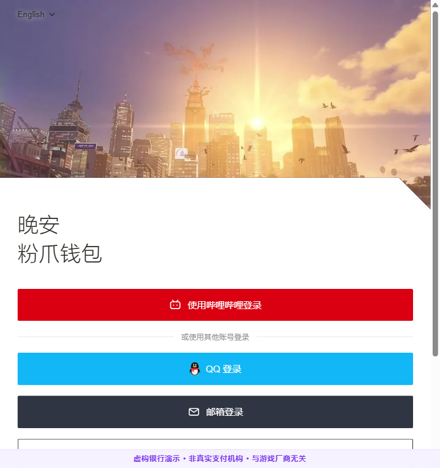
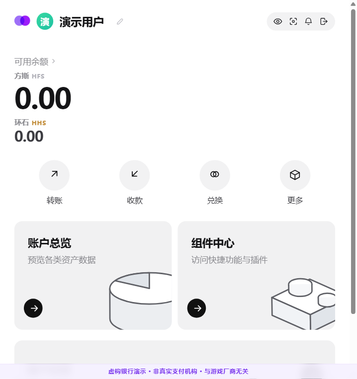
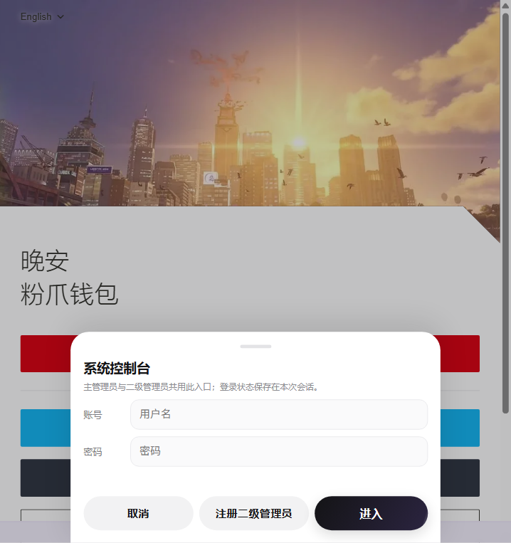
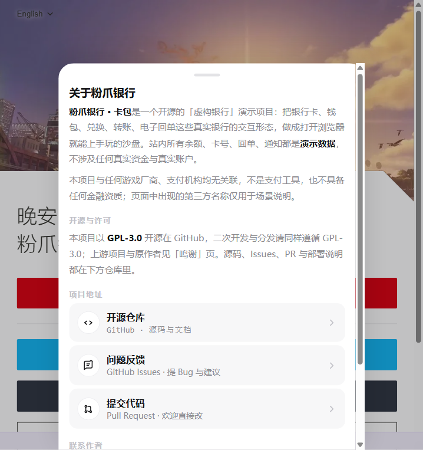
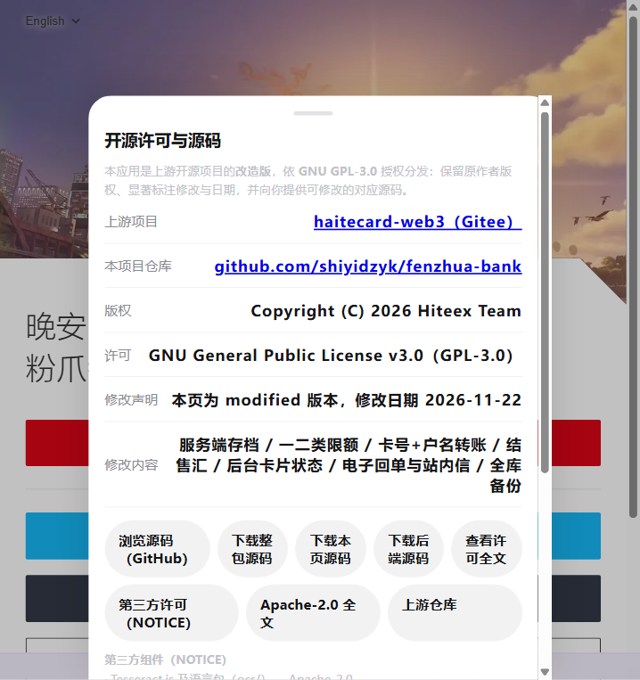

# 粉爪银行 · 卡包

**中文** | [English](README.en.md)

一个能真的登录、真的存数据、真的转账的「虚构银行」演示站：把银行卡、双币钱包、结售汇、转账、电子回单这些真实银行 App 的交互，做成打开浏览器就能玩的沙盘。所有余额、卡号、流水、回单都是演示数据，不涉及任何真实资金。

- 演示站：<https://fenzhua.yzz.me/>
- 本仓库：<https://github.com/shiyidzyk/fenzhua-bank>
- 二次开发说明（改了哪里、怎么实现的）：[DEVELOPMENT.md](DEVELOPMENT.md)（[English](DEVELOPMENT.en.md)）
- 变更日志：[CHANGELOG.md](CHANGELOG.md)（[English](CHANGELOG.en.md)）

> 本仓库即演示站的**对应源码**（GPL-3.0 要求的可修改源码），不是「只放个介绍」的镜像仓库。

---

## 目录

- [这是什么 / 不是什么](#这是什么--不是什么)
- [基于上游哪个项目](#基于上游哪个项目)
- [相对上游做了什么](#相对上游做了什么)
- [功能一览](#功能一览)
- [界面预览](#界面预览)
- [怎么用](#怎么用)
- [主管理员账密这样改（加固流程）](#主管理员账密这样改加固流程)
- [怎么构建与部署](#怎么构建与部署)
- [目录结构](#目录结构)
- [技术栈与数据流](#技术栈与数据流)
- [开发与贡献](#开发与贡献)
- [常见问题](#常见问题)
- [许可与致谢](#许可与致谢)

---

## 这是什么 / 不是什么

**是**：一个完整可运行的演示应用 —— 单页面前端 + 单个 PHP 接口 + 一张 MySQL 表。可以注册、设 PIN、开户验资、开卡、改卡状态、转账、买卖外汇、看回单；管理后台能改余额、管卡片、导 JSON/CSV、备份全库、删号。

**不是**：支付工具、金融产品、真实银行系统。没有真实资金通道，没有金融资质，与游戏厂商、支付机构均无关联；站内「方斯 / 环石」是虚构币种。

面向的两类人：

- 想体验银行 App 交互形态的普通用户 —— 直接开演示站玩；
- 想研究「单文件前端 + 轻后端怎么做完整业务闭环」的开发者 —— 读 [DEVELOPMENT.md](DEVELOPMENT.md) 再改。

---

## 基于上游哪个项目

本项目是 **haitecard-web3** 的二次开发（derivative work）：

| 项 | 内容 |
|---|---|
| 上游仓库 | <https://gitee.com/hiteex/haitecard-web3> |
| 上游作者 | LING不道（B 站主页：<https://b23.tv/z2IIXcU>） |
| 上游许可 | GNU GPL-3.0 |
| 上游版权 | Copyright (C) 2026 Hiteex Team |
| 本项目许可 | GNU GPL-3.0（见 [LICENSE.txt](LICENSE.txt)） |
| 修改起始日期 | 2026-11-22 |

上游给的是「纯前端单文件」的卡包 Demo：卡面、钱包、兑换、扫码这些交互形态与素材来自上游。本项目的改造集中在一个方向 —— **把它从「本机存档的单机 Demo」变成「有服务端、有多账号、有权限、能对账的托管应用」**，同时保留上游的单文件前端形态。

许可义务说明：本项目保留上游版权声明、在源文件头部标注「modified + 修改日期」、并把完整对应源码放在本仓库（GPL-3.0 §5）。二次分发请同样以 GPL-3.0 开放源码，并阅读 [NOTICE.txt](NOTICE.txt)。

---

## 相对上游做了什么

### 1. 存储与服务端（新增）

| 改动 | 说明 |
|---|---|
| 新增 `api.php` | 单个 PHP 入口承载全部业务动作（`?a=` 或 body 的 `act`） |
| MySQL + 文件双存储 | 连库成功走 MySQL；失败自动退到 `data/store.php`（带文件锁） |
| 账号存档模型 | `pc_users` 一行一个账号，`st` 列存整份业务状态 JSON |
| 乐观锁 `ver` | 每次写入版本 +1；旧版本写入返回 `conflict`，避免旧页面覆盖新存档 |
| 每版快照 | 写库前把上一版落 `data/bak/`，每账号保留最近 20 份 |
| 删除墓碑 | 删号写墓碑，旧页面再同步会得到 `gone`，不会「复活」账号 |
| UID 冻结 | 销号后站内 UID 永久冻结，不再分配 |
| 电子回单 / 站内信 | 服务端生成回单（含印章样式要素）与通知，各账号上限 30 / 60 条 |

### 2. 业务能力（新增）

| 改动 | 说明 |
|---|---|
| 一二类账户限额 | Ⅱ类：单笔 1 万 / 日 1 万 / 年 20 万 / 日 10 笔，禁购汇；Ⅰ类（已开卡）：单笔 50 万 / 日 200 万 |
| 卡号 + 户名转账 | Luhn 校验卡号，卡号与户名双匹配，禁自转，双边落账 + 双方回单 + 双方通知 |
| 结售汇 | 方斯（HFS）⇄ 环石（HHS），买入用卖出价、卖出用买入价，Ⅱ类禁购汇 |
| 卡片生命周期 | 开卡 / 冻结 / 激活；无卡号时服务端发卡（BIN `888888`、有效期 5 年、CVC 派生） |
| 限额实时计算 | 日/月/年计数按日期自动滚期，写入存档时累计 |

### 3. 前台交互（改造）

| 改动 | 说明 |
|---|---|
| 首页消费统计 | 改为按流水实时算今日 / 近 30 日（原先写死 3.18、且首开虚构一条「+11 现金存入」但不入账） |
| 登录流程 | 游客 / QQ / 哔哩哔哩三入口；登录后设 4 位 PIN；刷新免重输，关标签页重验 |
| 换设备登录 | 先探测云端是否已有该账号，有则走 PIN 验证，不误建新档 |
| 失败分流 | `gone` / `auth` / `pin_mismatch` / `conflict` 各有对应处理，不再「静默失败」 |
| 关于 / 鸣谢 / 开源许可 | 三个信息页，仓库、Issues、PR、邮箱、上游归属、许可全文与源码下载入口 |

### 4. 安全（改造，这是与上游差别最大的部分）

| 改动 | 原来的问题 |
|---|---|
| 用户令牌 `utk` + `userauth` | 原先 `get` 无鉴权返回整条存档（含 PIN 摘要），`push` 谁都能写 |
| `get` 收窄 | 只有本人令牌或授权管理员能拿完整存档；匿名只回 `found/gone/hasPin/name` |
| `push` 三通道鉴权 | 用户令牌 / 管理员范围 / 与云端一致的 PIN 摘要；新建账号另有每小时 200 条节流 |
| PIN 存储升级 | 从无盐 `sha256(PIN)` 惰性升级为 PBKDF2-SHA256（10 万次迭代 + 随机盐） |
| 登录限流 | 连错 5 次锁 600 秒，锁定期间连正确 PIN 也拒绝；失败与拒绝写审计日志 |
| 令牌分仓 | 用户令牌存 localStorage，管理员令牌存 sessionStorage，退出后台即清 |
| 权限判定下沉 | 二级管理员只能管绑定账号（`scopeCan`），前端缺省不再回退成 root |
| 凭据外置 | 库口令与密钥移到 `config.php`（`.gitignore` 排除），公开仓库里只剩占位 |
| `data/` 拒绝访问 | `.htaccess` / `nginx.conf` 拦掉 `data/` 与 `.json/.log/.py/.md` 等内部文件 |

完整的改动清单与实现位置见 [DEVELOPMENT.md §5](DEVELOPMENT.md)。

---

## 功能一览

**用户侧**

- 登录：游客 / QQ / 哔哩哔哩；首次设置 4 位 PIN
- 开户：上传游戏内账户截图，本地 OCR 识别 UID 与余额（Tesseract.js，离线、不外发图片）
- 卡片：开卡、冻结、解冻、查看卡号/CVC/有效期
- 钱包：双币余额、收支流水、今日与近 30 日消费统计、返现
- 转账：填卡号 + 户名 + 金额，二次 PIN 确认，生成回单
- 结售汇：按牌价买入/卖出环石，成交回单记汇率与出入金额
- 通知中心：卡片变更、转账到账、后台操作记录
- 信息页：关于 / 鸣谢 / 开源许可

**管理侧**

- 主管理员（root）：全部账号、改余额、卡片状态、导出 JSON / CSV、全库备份、删号（写墓碑）、清理仅本机残留记录
- 二级管理员（sub）：只看得到绑定给自己的那一个账号，导出与备份入口隐藏
- 两个前端入口校验 + 服务端 scope 双重判定（真正的权限在服务端）

---

## 界面预览

> 以下截图来自演示实例，账号为游客创建的「演示用户」，余额 0.00，不含任何真实数据。

| 登录页 | 首页与卡包 |
|---|---|
|  |  |
| 风景头图 + 45° 缺角（这个缺角就是管理端隐藏入口），下方是登录方式 | 双币余额、转账/收款/兑换/更多四个入口、账户总览与卡片 |

| 系统控制台（隐藏入口） | 关于页 |
|---|---|
|  |  |
| 头图右下角缺角点一下弹出的登录框，主管理员与二级管理员共用，登录态只存在本轮会话 | 仓库、Issues、Pull Request 三条链接与实际联系方式 |



许可面板：本项目仓库地址 + 一键下载整包 / 单文件，以及 LICENSE、NOTICE、Apache-2.0 全文与上游仓库入口。

---

## 怎么用

### 普通用户

1. 打开 <https://fenzhua.yzz.me/>，选一种登录方式（游客最快）。
2. 首次进入设置 4 位 PIN —— 之后登录、转账、兑换都用它。
3. 完善资料（昵称、头像），进首页。
4. 想开卡：进「账户总览」→ 立即开通 → 上传游戏内账户截图 → 本地识别 UID 与余额。
5. 开卡后可转账（卡号 + 户名）、可结售汇；未开卡属于Ⅱ类账户，受限额外加「不可购汇」。
6. 每次成交都会生成回单，通知中心可查。
7. 刷新页面免 PIN，关闭标签页 / 退出登录后需要重输。

> 演示环境，别填真实身份信息；截图里也尽量不要带隐私内容。

### 管理员

入口是隐藏的：登录页头图右下角 45° 缺角点一下，或首页长按左上角品牌标志约 1.2 秒。

默认账密（开箱即用，方便你登录自己部署的实例）：

```
用户名：xiaozhi888
密码：  xz668866
```

这是**演示默认值**，不是安全边界：正式对外公开前请自行替换。本仓库当前代码需要 `config.php` / `data/root.json` / `index.html` 的 `ADMIN_HASH` 三处同步（见 [部署第 6 步](#怎么构建与部署)）；线上站已改用下一节的加固流程。

---

## 主管理员账密这样改（加固流程）

> **代码状态**：本节记录的是线上站 `https://fenzhua.yzz.me/` 已生效的改密流程，**尚未并入本仓库**。仓库里的 `api.php` 仍是旧版（无当前口令校验、密码最少 6 位、只写 `data/root.json`），`index.html` 仍内置 `ADMIN_HASH`。先读设计、再决定是否移植。
>
> **仓库默认演示账密保持 `xiaozhi888` / `xz668866` 不变**，本次文档改动不涉及任何真实账密；线上实例的账密属于运行数据，任何时候都不写进仓库。

### 它解决什么

| 老问题 | 加固后的处理 |
|---|---|
| 改完就忘 | 后台内自助修改，且**必须输入当前口令**，不会再出现"谁改的、改成什么都不知道" |
| 三处不一致（`config.php` / `data/root.json` / 前端哈希） | 服务端单一真相：`data/root.json` 生效；改密时自动把 `config.php` 同步成同一组值，前端不再存口令摘要 |
| 旧账密还能用 | 管理员令牌与账密绑定（签名里含 `sha256(口令)`），改完旧令牌立即失效；旧口令不再匹配任何入口 |
| 改一半失败 | 先写 `root.json` 再写 `config.php`，后者失败即回滚前者，绝不留下"文件各认一套"的中间态 |

### 正确路线（只有这一种顺序）

1. 后台「修改主管理员账密」弹层：`当前密码` → `账号`（预填当前值） → `新密码`（留空即只改账号）。
2. 前端本地预检：当前密码非空、新密码 8–64 位且不等于当前、账号或密码至少改一项。
3. `POST api.php`，`act=rootset`，带管理员令牌 `t` 与 `op`（当前口令）、`u`、`p`。
4. 服务端依次执行：
   - 令牌必须是 `root`（`SCOPE['role'] === 'root'`），否则 `auth`；
   - `!admincred` 限流检查（5 次失败锁 600 秒），命中返回 `locked` + `wait`；
   - `hash_equals(当前口令, op)`，空 → `need_current`，错 → `bad_current`（返回 `left`、`wait`）；
   - 账号 3–20 位 `A-Za-z0-9_.-`、不得与二级管理员重名 → `bad_name` / `name_taken`；新密码 8–64 位、不得与当前相同 → `bad_pass` / `same_pass`；两项都没改 → `nothing`；
   - 写 `data/root.json`（唯一生效来源，存在即覆盖 `config.php` 中的同名配置），失败 → `write_fail`；
   - 同步 `config.php`：只精确替换 `ADMIN_USER` / `ADMIN_PASS` 两行，旧文件备份到 `data/bak/config.prev.php`，临时文件写在 `data/` 再 `rename()` 原子替换，最后回读校验；
   - 同步失败 → **回滚 `root.json`**，返回 `cfg_write_fail`（提示会说明"已回滚，旧账密仍有效"）；
   - 成功 → 清限流、写审计 `rootset ok user=… pass_changed=0/1`，前端 `adminClose()` 并跳回登录页。
5. 用新账密重新登录后台。

### 改完之后哪些东西立即失效

| 对象 | 结果 |
|---|---|
| 旧密码 | 不再匹配：后台登录与 `rootset` 的当前口令校验都会拒绝 |
| 旧管理员令牌 | 立即失效。令牌是 `SECRET` 对「版本标记 + 用户名 + 口令摘要」的 HMAC，账密一变签名就对不上 |
| 前端管理员会话 | 保存成功即 `adminClose()`，清 `sessionStorage` 管理员键并回登录页 |
| `data/root.json` | 新账密（生效来源） |
| `config.php` | 同步为新账密，只作兜底/可移植配置，不再出现"文件旧、实际新" |
| `data/audit.log` | 追加成功或失败记录（失败含 `bad_current` / `cfg_<why>`） |

### 错误码对照

| `err` | 含义 | 旧账密是否仍有效 |
|---|---|---|
| `auth` | 不是主管理员，或令牌已失效 | 是 |
| `need_current` | 没填当前密码 | 是 |
| `bad_current` | 当前密码错误（带 `left`、`wait`） | 是 |
| `locked` | 尝试过多，需等 `wait` 秒 | 是 |
| `same_pass` | 新密码与当前相同，拒绝"假改密" | 是 |
| `bad_pass` / `bad_name` / `name_taken` | 格式或重名校验失败 | 是 |
| `nothing` | 账号、密码都没改 | 是 |
| `write_fail` | `data/` 不可写 | 是 |
| `cfg_write_fail` | `config.php` 同步失败并已回滚 | 是 |

### 真的忘了怎么办

流程要求当前口令，所以"忘了"不能靠它自救。恢复只有一条路：用主机面板 / FTP 打开 `data/root.json`，改成一组你记得住的账密（`{"user":"…","pass":"…","ts":…}`），保存即生效（`root.json` 覆盖 `config.php`），旧令牌同时失效。之后进后台再走一次正常改密，把 `config.php` 与 `root.json` 对齐。

### 边界

- 真实账密只存在服务器 `data/root.json` 与 `config.php`；两者都不入仓库，并被 `.htaccess` / `nginx.conf` 拒绝公网读取（改密时生成的 `data/bak/config.prev.php`、`data/audit.log` 同样 403）。
- 本节不含任何具体账密。仓库里的 `xiaozhi888` / `xz668866` 是演示默认值，部署后请自行替换，替换方式见上一节。
- 加固版删除了 `ADMIN_HASH` 与"服务端不可达时用前端哈希登录"的离线兜底：后台只能在线校验，前端不再持有任何口令摘要。

---

## 怎么构建与部署

### 先说结论：没有构建步骤

前端是一个 `index.html`（内联 CSS/JS，jsQR 已内嵌），后端是一个 `api.php`。没有 npm、没有 webpack、没有产物目录 —— **改完文件直接传上去就是最新版本**。

「构建」在这里只剩两件事：**准备私有配置** 和 **建表**。

### 运行环境

- PHP 8.0+（用到 `random_bytes`、`hash_pbkdf2`、`hash_equals`；无需额外扩展，PDO MySQL 可选）
- MySQL 5.7+ / MariaDB（可选；没有库也能用文件存储跑起来）
- Web 服务器：Apache / LiteSpeed（用仓库里的 `.htaccess`）或 Nginx（用 `nginx.conf`）
- 不需要 Node.js；本地预览只需要 Python 3（`serve.py`）或 PHP 自带服务器

### 部署步骤

**1. 放文件**

把仓库内容传到站点根目录，至少包含：

```
index.html  api.php  config.php  .htaccess  img/  ocr/  bili-card.php  LICENSE.txt
```

`index.html` 引用的图片是相对路径 `img/…`，`ocr/` 也必须是同级目录，**不能只传 index.html 一个文件**。

**2. 写私有配置**

复制模板并填值：

```bash
cp config.example.php config.php
```

```php
<?php
return [
  'CFG' => [
    'host' => '127.0.0.1', 'port' => 3306,
    'user' => 'db_user', 'pass' => 'db_password',
    'db'   => 'db_name',        // 留空则自动探测与用户名同名的库
    'timeout' => 6,
  ],
  'SECRET'     => '改成一串随机 32 位以上字符',   // 所有令牌的 HMAC 密钥
  'ADMIN_USER' => 'xiaozhi888',                   // 默认管理员；对外公开前请替换
  'ADMIN_PASS' => 'xz668866',                     // 同上
];
```

`config.php` 已在 `.gitignore` 中，**不要提交、不要写回 `api.php`**。`api.php` 是能被公开下载源码的（`?a=source`），凭据硬编码等于一起公开。

**3. 建表（用 MySQL 时）**

```sql
CREATE TABLE pc_users (
  k      VARCHAR(160) PRIMARY KEY,  -- 账号键：provider:account
  p      VARCHAR(16),               -- provider（guest / qq / bili）
  a      VARCHAR(160),              -- 平台内账号
  name   VARCHAR(64),               -- 昵称（全站唯一）
  avatar TEXT,
  pin    VARCHAR(128),              -- 旧格式 PIN 摘要（兼容用，v2 记录在 data/pinv2.json）
  st     LONGTEXT,                  -- 业务状态 JSON
  ver    INT,                       -- 版本号（乐观锁）
  upd    BIGINT
);
```

不建表也能跑：接口会退到 `data/store.php` 文件存储，适合先本地看效果。

**4. 目录权限**

```
data/          可写（0705），存放 store.php / tomb.json / frozen.json / root.json /
               admins.json / pinv2.json / rl.json / audit.log / db.json / rates.json / bak/
```

`data/` **必须禁止公网访问**：Apache/LiteSpeed 用仓库里的 `.htaccess`；Nginx 必须自己加：

```nginx
location ~ ^/data/ { deny all; }
```

**5. 上传顺序（重要）**

```
config.php  →  api.php  →  打一次 ping  →  index.html
```

反了会有一小段时间登录失败（前端已经在调新接口，后端还是旧的）。

健康检查：

```bash
curl https://你的域名/api.php?a=ping
# {"ok":1,"php":"8.4.x","store":"mysql"}
```

**6. 同步前端入口摘要**

`index.html` 里有一个常量：

```js
const ADMIN_HASH = '…';
```

它必须等于 `sha256Hex('pinkclaw::admin::' + 用户名 + '::' + 口令)` 的小写十六进制值。只改 `config.php` 不同步它，后台入口会一直提示「账号或密码不正确」。

自己算一下（浏览器控制台或任意 SHA-256 工具，注意是 UTF-8）：

```js
// 页面里已有 sha256Hex，但它在闭包里；用 WebCrypto 等价写法
const s = 'pinkclaw::admin::你的用户名::你的口令';
const hex = Array.from(new Uint8Array(await crypto.subtle.digest('SHA-256', new TextEncoder().encode(s)))
  ).map(b => b.toString(16).padStart(2, '0')).join('');
```

> 这层只是前端入口闸门，真正的权限判定在 `api.php` 的 `scopeOf / scopeCan`。因此**不要把 ADMIN_HASH 当成安全边界**。

**7. 本地预览（可选）**

纯前端、不跑业务：

```bash
python3 serve.py            # http://localhost:8777
python3 serve.py 8080       # 指定端口
```

要跑完整业务（登录、存档、转账）：

```bash
php -S 127.0.0.1:8080       # 需要同目录有 index.html、api.php、config.php
```

然后访问 `http://127.0.0.1:8080/`。没有库时接口自动用文件存储，`data/` 会被自动创建。

**8. 上线前自检**

- `api.php?a=ping` 正常
- 能登录、能建档、刷新免 PIN
- 错 PIN 连错 5 次会被锁
- 转账在卡号或户名错时拒绝
- 未开卡账号购汇被拒
- `data/pinv2.json`、`data/audit.log` 直链返回 403
- 完整回归用例见 [DEVELOPMENT.md §6.5](DEVELOPMENT.md)（13 条）

### 打包分发

没有构建产物，直接打 zip 即可，注意排除私有与运行期文件：

```bash
git archive --format=zip -o fenzhua-bank.zip HEAD
```

或从 GitHub 下载：<https://github.com/shiyidzyk/fenzhua-bank/archive/refs/heads/main.zip>

---

## 目录结构

```
index.html                   前端全部代码（HTML + CSS + JS + 内嵌 jsQR）
api.php                      后端唯一入口（POST JSON，或 GET ?a=xxx）
config.example.php           私有配置模板 → 复制成 config.php
bili-card.php                B 站公开资料同源代理（规避 CORS）
oauth-callback.example.php   第三方登录回调示例
.htaccess                    Apache/LiteSpeed 规则：MIME、缓存、data/ 拒绝访问
nginx.conf                   Nginx 参考配置
serve.py                     本地静态服务器（Python 3，零依赖）
img/                         品牌、卡面、示例余额、立绘、QQ 图标
ocr/                         Tesseract.js 5.1.1 + core + eng 语言包（离线 OCR）
LICENSE.txt                  GPL-3.0 全文
NOTICE.txt                   上游归属与第三方组件声明
LICENSES/Apache-2.0.txt      Apache-2.0 全文（Tesseract.js、jsQR）
README.md                    本文件（中文）
README.en.md                 English README
DEVELOPMENT.md               架构、接口、改动清单、二次开发指南、回归用例（中文）
DEVELOPMENT.en.md            English developer & handover manual
CHANGELOG.md                 变更日志（中文）
CHANGELOG.en.md              English changelog
docs/                        README 用的界面截图（演示数据）
```

---

## 技术栈与数据流

```
浏览器（index.html：state + localStorage 缓存）
        │  POST JSON  /  GET ?a=xxx
        ▼
api.php ── scopeOf(token) / userScopeOf(utk) / pinV2Check
        │            │
        │            ├── data/pinv2.json    PIN v2（PBKDF2）
        │            ├── data/rl.json       登录限流计数
        │            ├── data/audit.log     审计
        │            ├── data/tomb.json     删除墓碑
        │            ├── data/frozen.json   冻结 UID
        │            └── data/bak/          每次写库前的旧版快照
        ▼
MySQL pc_users（k, p, a, name, avatar, pin, st, ver, upd）
        └ 连不上 → data/store.php（文件存储，文件锁）
```

几个关键约定：

- **`st` 是整份业务状态 JSON**，前端 `state` 与它一一对应；`lim`（限额计数）、`cardState`、`pcuid` 由服务端强制对齐，客户端改不动。
- **`ver` 是乐观锁**，`push` 不带 `ver` 会被判 `conflict` 且静默不写。
- **HTTP 恒 200，成败看 `ok`**；错误码见 [DEVELOPMENT.md §3.1](DEVELOPMENT.md)。

---

## 开发与贡献

- 想改功能：先读 [DEVELOPMENT.md](DEVELOPMENT.md)，里面有「新增服务端动作 / 新增前端页面 / 新增状态字段」的模板。
- 提 Bug / 建议：<https://github.com/shiyidzyk/fenzhua-bank/issues>
- 提代码：直接开 Pull Request；改动较大建议先开 Issue 聊方向。
- 不用 GitHub 也可以：发邮件到 <shiyi363@qq.com>，附复现步骤与截图。

改完请至少跑一遍本地自检：

```bash
php -l api.php      # 语法
node --check …      # 若单独抽了 JS
```

上线顺序永远是 `api.php` → `ping` → `index.html`。

---

## 常见问题

**Q：后台提示「账号或密码不正确」，但口令明明是对的？**
本仓库旧版代码三处要保持一致：`config.php`、`data/root.json`（存在则覆盖 config）、`index.html` 的 `ADMIN_HASH`。少改一处就会失败，另外先强刷（`Ctrl+Shift+R`）。线上加固版已不再有 `ADMIN_HASH`，只需 `root.json` 与 `config.php` 一致（改密时自动同步），详见[上一节](#主管理员账密这样改加固流程)。

**Q：主管理员账密改完就忘了，怎么办？**
加固流程要求当前口令，忘了就无法自助修改。用主机面板 / FTP 编辑 `data/root.json` 写一组记得住的新账密，保存即生效（它覆盖 `config.php`），旧令牌同时失效；之后进后台再走一次正常改密让两边对齐。

**Q：操作成功了，刷新又回退？**
`push` 没带 `ver`，被判 `conflict` 且静默不写。带上版本号（前端 `apiVer`）再试。

**Q：登录后被要求重新设 PIN？**
服务端探测不到该账号的 PIN（可能刚被重置），会走「首次设置」流程。用 `userauth` 正常验证过的账号不会出现。

**Q：`data/pinv2.json` 能直接下载？**
说明 `data/` 没拦住。Apache/LiteSpeed 检查 `.htaccess` 是否生效（`AllowOverride`），Nginx 加 `location ~ ^/data/ { deny all; }`。

**Q：OCR 不识别？**
`ocr/` 必须整目录上传（含 `tesseract-core-*.wasm`、`worker.min.js`、`lang/eng.traineddata.gz`），且这些文件不能被 `.htaccess` 规则误拦。

**Q：没有 MySQL 能用吗？**
能。接口退化为 `data/store.php`，功能一致，只是并发与容量弱一些。

---

## 许可与致谢

- 本项目依 **GNU General Public License v3.0** 分发，全文见 [LICENSE.txt](LICENSE.txt)。
- 上游：**haitecard-web3**（<https://gitee.com/hiteex/haitecard-web3>，Copyright (C) 2026 Hiteex Team，GPL-3.0）。感谢原作者 **LING不道** 在开发过程中提供的技术建议与答疑；产品形态、卡面与大量交互细节源自上游。
- 第三方组件：Tesseract.js 及语言包、jsQR（Apache-2.0，全文见 `LICENSES/Apache-2.0.txt`）；哔哩哔哩 Toy SDK 与公开接口为运行时外链，未随本仓库分发。详见 [NOTICE.txt](NOTICE.txt)。
- 「粉爪银行」「Haitecard」「小吱」「久留美」等名称与角色形象用于虚构演示，不表示与任何真实机构、游戏厂商存在关联；GPL-3.0 不授予商标使用权。

## 免责声明

本项目为虚构银行同人演示，与游戏、厂商、支付机构无关，不构成任何金融服务，也不是支付工具。请勿用于任何形式的真实资金场景。

